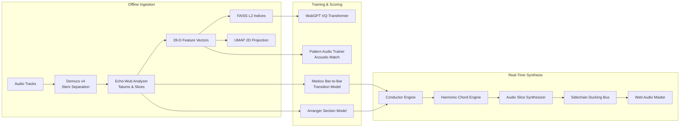

# 📐 Wub KG-505 Architecture & Technical Specifications

This document details the signal processing pipeline, machine learning models, synthesis algorithms, and Web Audio DSP implementations of the **Wub KG-505** groovebox.

---

## 1. Pipeline Overview



---

## 2. Audio Analysis & Feature Extraction

### Echo-Wub Metrical Hierarchy
Every track ingested into Wub undergoes metrical decomposition:
1. **Beats**: Detected using `librosa.beat.beat_track` locked to drum onset envelopes.
2. **Bars**: Grouped into 4-beat musical bars (in 4/4 time signature).
3. **Tatums (1/16th notes)**: Subdivided into 4 tatums per beat (16 tatums per bar).
4. **Per-Stem Onset Slices**: Onset detection functions (`librosa.onset.onset_detect`) run per stem with backtracking to locate the exact zero-crossing transient attack ($t_0 \pm 3\,\text{ms}$).

### 28-Dimensional Acoustic Feature Vector
Each audio slice segment is characterized by a 28-D descriptor:
- **12-D MFCCs** (Mel-Frequency Cepstral Coefficients): Captures spectral envelope, formant timbre, and acoustic texture.
- **12-D Chroma Polyphony**: Normalized 12-bin semitone energy distribution ($C, C\sharp, D, \dots, B$).
- **1-D Loudness Peak**: Maximum RMS amplitude in dB relative to full scale.
- **1-D Loudness Mean**: Average RMS energy across segment duration.
- **1-D Duration**: Segment length in seconds (typically $0.05\,\text{s}$ to $1.2\,\text{s}$).
- **1-D Spectral Centroid**: Normalized center of mass of the frequency spectrum (acoustic brightness).

---

## 3. Machine Learning & Generative Models

### A. Physical Acoustic Slice Classifier (`wub_core/groovy_pattern_assembler.py`)
To prevent non-musical slice assignment (e.g., placing a sub-bass slice where a hi-hat belongs), slices are physically classified into discrete acoustic roles:
- **`kick`**: Centroid $< 350\,\text{Hz}$, duration $0.08\,\text{s} \dots 0.45\,\text{s}$, high peak loudness.
- **`snare`**: Centroid $900\,\text{Hz} \dots 3200\,\text{Hz}$, duration $0.08\,\text{s} \dots 0.35\,\text{s}$.
- **`hat_closed`**: Centroid $> 4500\,\text{Hz}$, duration $< 0.12\,\text{s}$.
- **`hat_open`**: Centroid $> 4000\,\text{Hz}$, duration $0.15\,\text{s} \dots 0.65\,\text{s}$.
- **`fill` / `percussion`**: Syncopated intermediate transients.
- **`sub` / `rolling` / `stab`**: Low-frequency bass categorized by duration and attack curve.
- **`chord` / `pad` / `arp`**: Pitch polyphony classified by chroma entropy and length.
- **`chop` / `phrase`**: Vocal cuts classified by formant energy ratios ($700\,\text{Hz} \dots 2.5\,\text{kHz}$).

### B. Camelot Key Harmonic Consonance
Key alignment is calculated across the 12-hour Camelot wheel ($1\text{A} \dots 12\text{B}$).
A slice with chroma vector $\mathbf{c} \in \mathbb{R}^{12}$ is evaluated against scale template $\mathbf{k} \in \{0, 1\}^{12}$:
$$\text{Consonance}(\mathbf{c}, \mathbf{k}) = \frac{\mathbf{c} \cdot \mathbf{k}}{\|\mathbf{c}\|_1 + \epsilon} - 1.5 \frac{\mathbf{c} \cdot (\mathbf{1} - \mathbf{k})}{\|\mathbf{c}\|_1 + \epsilon}$$
Slices with high dissonant energy outside the scale are penalized, ensuring that polyphonic mixes remain consonant.

### C. Pattern Audio Waveform Matching (`wub_core/pattern_audio_trainer.py`)
The system measures acoustic similarity between synthesized candidate patterns and real electronic songs:
1. Candidate pattern slices are assembled into continuous audio waveforms using $3\,\text{ms}$ equal-power crossfades:
   $$g_{\text{in}}(t) = \sin\left(\frac{\pi t}{2 L}\right), \quad g_{\text{out}}(t) = \cos\left(\frac{\pi t}{2 L}\right)$$
2. Corresponding authentic reference bars are extracted from the training corpus.
3. Multi-scale similarity metrics are evaluated:
   - **Log-Mel Spectrogram Cosine Distance**: Measures frequency balance match.
   - **Onset Envelope Pearson Correlation**: Measures rhythmic pocket alignment.
   - **Chroma Correlation**: Measures harmonic progression agreement.
   - **Dynamic Range Profile**: Measures transient-to-decay RMS ratio.

### D. WubGPT (Causal Multi-Stem Transformer)
- **Architecture**: 6 layers, 8 attention heads, embedding dimension $d=384$, context window $L=64$ tatums (4 full bars).
- **Vocabularies**: 512 Vector Quantizer (VQ) acoustic codebook clusters per stem plus 1 silence token ($V=513$).
- **Inference**: Top-P nucleus sampling ($p=0.90$, temperature $T=0.85$) with gravity conditioning guiding the sampling distribution toward user-selected coordinates in the UMAP latent space.

---

## 4. In-Browser Sound Engine & Web Audio DSP

### Dual Bus Architecture & Sidechain Ducking
```
[ Kick Node ] ───────────────────────► [ Master Limiter ]
     │ (transient trigger)
     ▼
[ Bass Gain Node ] ── (duck to 0.35, exp release 75ms) ──► [ Master Limiter ]
     ▲
     │
[ Sub Synth / Slices ]

[ Synth Gain Node ] ── (duck to 0.63, exp release 60ms) ──► [ Master Limiter ]
     ▲
     │
[ Chord / Arp / Pad ]
```

1. **Kick Transient Ducking**:
   On every downbeat kick, the bass gain is ducked to $0.35$ (approx. $-9\,\text{dB}$) and exponentially ramps back to $1.0$:
   ```ts
   gain.cancelScheduledValues(t);
   gain.setValueAtTime(0.35, t);
   gain.exponentialRampToValueAtTime(1.0, t + 0.075);
   ```
   This prevents low-frequency phase cancellation between the kick sub body ($45\,\text{Hz}$) and bass synths ($55\,\text{Hz} \dots 110\,\text{Hz}$).

2. **Metallic Hi-Hat Synthesis & Choking**:
   Six square-wave oscillators clustered at inharmonic metallic ratios ($2.8\,\text{kHz}, 3.4\,\text{kHz}, 4.2\,\text{kHz}, 5.1\,\text{kHz}, 6.8\,\text{kHz}, 8.5\,\text{kHz}$) filtered through a $7.5\,\text{kHz}$ high-pass filter.
   When a closed hi-hat triggers, any active open hi-hat gain node is immediately muted with a $15\,\text{ms}$ exponential ramp to zero, replicating physical acoustic hi-hat choking.

3. **Dynamic Slice Repitching**:
   When playing authentic slice WAVs from the corpus:
   $$\text{playbackRate} = 2^{\frac{\text{targetPitch} - \text{slicePitch}}{12}}$$
   Web Audio dynamically resamples the buffer with sub-sample linear interpolation, pitch-shifting the authentic audio slice to follow the harmonic chord progression without changing the underlying sequencer grid tempo.

---

## 5. WebGL Psychedelic Shader Architecture

The background visualizer (`frontend/src/psychedelic_bg.ts`) runs a GPU fragment shader computing:
1. **Raymarching Folded Fractals**: Modulo space-folding (`mod(p, 2.0) - 1.0`) with borderless polar wrapping to eliminate visible screen seam artifacts.
2. **Audio Reactive Uniforms**:
   - `u_energy`: Master RMS amplitude modulating fractal recursion depth.
   - `u_bass`: Low-frequency energy modulating color cycling and spatial warping.
   - `u_speed`: Master sequencer BPM scaling continuous raymarching time.
3. **Color Palettes**:
   - `DMT`: High-contrast neon purples, hot magentas, cyber teals, and intense greens.
   - `LSD`: Shifting rainbow spectrum with liquid melting domain distortion.
   - `Mescaline`: Warm earthen golds, oranges, ambers, and fiery reds.
