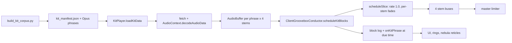

# 🎛️ Kit Engine — Song-Kit Phrase Jukebox

**Status:** shipped in the `v0.2.x` site. `kit` is the default playback mode.
The **cluster bank** enables the per-stem remix engine; the original single-kit
block player remains as a fallback for older manifests.

This is **not** VQ/medoid slice synthesis. A **kit** is one real four-stem track.
A **phrase** is a real 4-bar window cut from that track, with the same time
range in every stem. In the legacy single-kit mode, phrases play at their
decoded rate (`playbackRate = 1.0`, no detune, no time-stretch). In the
per-stem remix mode, each stem is a separate phrase stream: the phrase is
tempo-fitted to the session grid (<= 2% rate) and transposed to the session key
(<= 5 semitones; vocals <= 3) with Signalsmith Stretch, never with
`playbackRate` resampling. The source's groove, micro-timing and per-stem
character survive; the per-stem runtime gain is a separate mixer layer.

---

## 1. Architecture and signal flow



- `KitPlayer` loads `data/kits/kit_manifest.json`, then
  `data/kits/taste_scores.json`. Assets are fetched from
  `data/kits/kits/<track_id>/*.opus` and decoded into `AudioBuffer`s.
- `ClientGrooveboxConductor.ensureKitPlayer()` picks a random kit with at
  least 6 phrases, calls `loadKit()`, then `applyKitLock()`.
- **Kit lock:** session tempo is `fitBpm = 960 / median_phrase_duration_sec`
  (four 4/4 bars = 16 beats), not the manifest's analysed BPM. The key comes
  from the kit's `key` field. The Camelot code and active progression are
  rebuilt at the new kit downbeat.
- **Block clock:** kit audio has its own `nextKitBlockTime` clock, independent
  of UI paint. It schedules one block ahead, extends the lookahead while late,
  and fast-forwards missed blocks instead of stacking phrases.
- **Per-phrase slots:** each block starts exactly where the previous phrase
  ends. `blockDurationSec = phrase.duration_sec`; the session BPM shown in the
  UI is `960 / blockDurationSec` for that slot.
- **Fades:** per-stem choke fades are 18 ms (drums), 60 ms (bass), 250 ms
  (other/vocals). Phrase-boundary seam fades are 6/12/20/20 ms so the source's
  own cut is not notched.
- **Bus automation:** the existing section stem-mix automation still rides the
  four stem buses in kit mode. It is applied after the phrase assets are
  decoded; the Opus files themselves are never re-normalised or re-gained.
- UI logs (`onKitPhrase`, set changes) are queued at scheduling time and
  drained when the audio clock comes within 150 ms of the block, not when the
  block is scheduled. No DOM mutation happens inside the scheduling loop.

Legacy step sequencing still runs for fallback modes, but it does not schedule
audio while `playbackMode === "kit"` and kit audio is active.

---

## 2. Asset layout

```text
frontend/public/data/kits/
├── kit_manifest.json          # fetched at boot
├── taste_scores.json          # fetched after the manifest
├── _track_index.json          # build cache; not fetched by the player
└── kits/
    └── <track_id>/
        ├── kit_<track_id>_p01_drums.opus
        ├── kit_<track_id>_p01_bass.opus
        ├── kit_<track_id>_p01_other.opus
        ├── kit_<track_id>_p01_vocals.opus
        └── ... pNN for each phrase
```

- Audio is mono Ogg Opus, 64 kbps by default. The manifest's `sample_rate`
  records the source rate (44.1 kHz), but **Ogg Opus always decodes at 48 kHz**;
  read `AudioBuffer.sampleRate` and never assume 44.1 kHz when converting
  frames to seconds.
- Asset `file` paths are relative to the manifest directory, e.g.
  `kits/<track_id>/kit_<track_id>_p01_drums.opus`.
- Current shipped bank: **355 kits / 2,466 phrases / ~602 MB** (`du -sh`), four
  styles: breaks, cyber, house, wave. Phrase counts per kit are 4–8.

### `kit_manifest.json`

```json
{
  "version": 1,
  "bars": 4,
  "sample_rate": 44100,
  "bitrate": "64k",
  "kits": [
    {
      "track_id": "00bd65091e8f21fd",
      "title": "00bd65091e8f21fd",
      "bpm": 86.133,
      "key": "F minor",
      "style": "wave",
      "source": "processed/00bd65091e8f21fd.json",
      "phrases": [
        {
          "id": "kit_00bd65091e8f21fd_p01",
          "section": "GROOVE_A",
          "start_bar": 14,
          "start_sec": 39.055964,
          "end_sec": 50.155102,
          "duration_sec": 11.099138,
          "energy": 0.0,
          "energy_db": -12.89,
          "embedding": [0.0123, -0.0456, 0.0312, "... 64 values"],
          "stems": {
            "drums": {"file": "kits/00bd65091e8f21fd/kit_00bd65091e8f21fd_p01_drums.opus", "peak": 0.7238, "rms_db": -18.21},
            "bass":  {"file": "kits/00bd65091e8f21fd/kit_00bd65091e8f21fd_p01_bass.opus",  "peak": 0.0483, "rms_db": -44.31},
            "other": {"file": "kits/00bd65091e8f21fd/kit_00bd65091e8f21fd_p01_other.opus", "peak": 0.5195, "rms_db": -25.4},
            "vocals":{"file": "kits/00bd65091e8f21fd/kit_00bd65091e8f21fd_p01_vocals.opus","peak": 0.5071, "rms_db": -28.05}
          },
          "x": 0.92,
          "y": 0.3063
        }
      ]
    }
  ]
}
```

`embedding` is a 64-d log-mel embedding of the 4-stem sum (mean over time,
spectral-tilt removed, L2-normalised). It drives kit novelty during corpus
selection and the nebula projection. `x`/`y` are deterministic PCA
coordinates added by `scripts/add_kit_coords.py`.

### `taste_scores.json`

```json
{
  "version": 1,
  "model": "taste_v1",
  "val_auc": 0.845219,
  "kits": {
    "<track_id>": {
      "phrase_order": ["kit_..._p01", "..."],
      "transition": [[0.0, 0.0287, 0.8887, "..."], "..."],
      "quality": [0.4714, 0.3699, 0.6452, "..."],
      "next": [
        {"track_id": "...", "score": 0.4083, "style": "wave", "bpm": 90.666, "key": "F minor"}
      ]
    }
  }
}
```

- `transition` is a row-stochastic phrase matrix, diagonal zeroed. A single
  global softmax temperature is tuned so median row max ≈ 0.52.
- `quality` scores each phrase as the successor of its own real aligned-window
  context, z-scored within style, then sigmoid-squashed.
- `next` is the top-10 next kits, filtered to the same style and `|Δbpm| <= 10`
  first; if fewer than 10 survive, the BPM window relaxes to 20 for that kit.

---

## 3. Sets, bridges, and kit rotation

- **One set = 12 four-bar blocks = 48 bars.**
- Blocks 1–11 play all four stems. By default, the **12th block is a drumless
  bridge**: only `other` and `vocals` are scheduled, so drums and bass drop out
  and the next kit can enter cleanly.
- The next kit starts preloading at block 10 (`blocksInSet === KIT_SET_BLOCKS - 3`).
- At the set boundary the player switches if `pendingLoadedKit` is ready. The
  new kit starts on the next block boundary with `setChanged = true` and
  `blocksInSet = 1`. If loading is not ready, the bridge extends and the player
  keeps retrying.
- If the next kit's BPM differs by more than 10 BPM, the bridge is **two
  blocks** instead of one.
- `NEXT KIT` (or `forceNextKit()`) forces the bridge on the next boundary. If
  it cannot preload in time, the bridge extends rather than glitching.
- **Rotation pool:** `chooseNextKit()` uses the current kit's taste `next` list,
  excluding the last 5 kits in history. Fallback is same style, Camelot
  distance ≤ 1, BPM within 4, then within 10, then the closest 8 available.
- **Phrase choice inside a set:** the arranger's live section selects the
  phrase pool. Missing target sections borrow the nearest allowed adjacent
  section (`INTRO → GROOVE_A → BUILDUP → DROP → BREAKDOWN`); DROP/GROOVE_A
  never borrow INTRO/BREAKDOWN. Energy bands are 0.15 and 0.25 within a
  section, widened to 0.35/0.40 on a section change. If nothing fits, the
  current phrase repeats rather than jumping outside the target section.
- **Taste weighting:** `weight = transition * (0.5 + quality) * stem_presence
  * steering_bias`, sampled proportionally. `stem_presence` is 1.0 with all
  four stems, 0.25 if any stem is effectively empty, and 0 if all are empty.
  Without `taste_scores.json`, the player falls back to rule-based selection
  (real +4-bar successor, section/energy match, embedding similarity,
  recency penalty).

---

## 4. Taste model and features

The taste dataset is **analysis JSON only** — no stem audio is opened. Every
non-overlapping 4-bar window on the bar grid gets one 48-d vector, plus one
off-grid window per kit phrase so every kit phrase joins exactly on
`(track_id, start_bar)`.

| Dims | Block | Contents |
| :--- | :--- | :--- |
| 0–11 | chroma | Mean `pitches` of unique non-silent bass/other/vocals segments in the window, L1-normalised; drums excluded. |
| 12–23 | timbre | Mean `timbre` of unique non-silent segments of all four stems. |
| 24–27 | onset density | Per stem: fraction of the 64 tatums whose segment id differs from the previous tatum. |
| 28–31 | loudness | Per-stem mean `loudness_max`, clipped −60..0 dB, mapped to 0..1. |
| 32 | energy | Mean of the four bar energies, mapped to 0..1. |
| 33 | energy slope | Normalised last bar minus first bar, −1..1. |
| 34–38 | section | One-hot of the first bar's section (INTRO / GROOVE_A / BUILDUP / DROP / BREAKDOWN). |
| 39 | since start | `(start_bar - section_start) / 16`, clipped 0..1. |
| 40 | vocal presence | Fraction of tatums whose vocals segment is audible (`loudness_max >= -50 dB`). |
| 41–47 | reserved | Zeros, reserved for future features. |

Two models are trained with a track-disjoint 90/10 split:

1. **Binary arrangement classifier** — `48 -> 128`, learned CLS + positional
   embedding, 4-layer / 4-head Transformer, 2-class head (~1.2M params). Real
   8-window sequences vs four corruptions: shuffle, same-style replacement,
   cross-track replacement, energy jump. BCE, AdamW, batch 128.
2. **Pairwise transition ranker** — context Transformer over the last 1–6
   windows, candidate MLP (`48 -> 128 -> 128`), cosine score with a learnable
   logit scale, InfoNCE against 1 positive + 7 same-track/same-style negatives.
   The shipped checkpoint uses context 6.

Shipped **ranker** metrics (held-out track split, seed 505; the 60-epoch
checkpoint is shipped):

| Ranker run | Within-kit top-1 | Full-track top-1 |
| :--- | ---: | ---: |
| 20 epochs | 51.5% (171/332) | 19.3% |
| **60 epochs (shipped)** | **59.0% (196/332)** | **23.8%** |
| 60 epochs + hard negatives | — | 22.2% |
| 60 epochs + context 8 | — | 23.0% |

Full-track top-5 stays ~74%, and the classifier's real-vs-shuffle AUC is
0.956. The d192/L4 120-epoch full-corpus run is in progress; those weights are
not shipped yet.

---

## 5. Nebula and reticles

- The base nebula is **every phrase of every kit**, plotted by the phrase's PCA
  `x`/`y` (2,466 points at 355 kits). It is dim and deliberately not the
  legacy UMAP slice cloud.
- The active kit's phrases are drawn as a bright highlight set, refreshed only
  when the kit rotates.
- When a block becomes due, `onKitPhrase` publishes that phrase's coordinate.
  Every bar, the four reticles glide (0.34 s) to the phrase point plus a small
  per-stem orbit (`0.034` radius), so each bar reads as a distinct spot.
- **Dragging only steers if the user actually drags.** No drag means no
  steering target (`steeringMultiplier = 1`), so the taste matrix alone picks
  phrases. Auto-follow is purely visual.
- For user-dragged stems, the bias is a Gaussian around the reticle
  (`sigma = 0.16`), mapped to `0.15 .. 2.55`. Hover freezes auto-follow;
  double-click releases the steering claim.
- If the mean drag target is **> 0.30** from every phrase in the active kit,
  the player requests a same-style, ±10 BPM kit change and uses the normal
  drumless bridge to get there.

---

## 6. Build and training (laptop)

Run from the repo checkout on the laptop (`cd /tmp/wubtrain`). The RTX 4050
does separation and taste training; the local GTX 1060 is reserved for L.O.V.E.
Analysis and frontend builds run on CPU.

Current corpus: **1,699 four-stem analyses** from **1,842 stem directories**
(342 GB) on the laptop; the full rebuild to 1,842 and a larger kit bank are
running.

```bash
cd /tmp/wubtrain
PROCESSED=/tmp/wubtrain/processed
STEMS=/mnt/e/Wub/data/stems

# 1. Analyse every 4-stem directory (idempotent; writes JSON per track).
PYTHONPATH=. python3 scripts/analyze_stem_corpus_vec.py \
  --stems "$STEMS" --out "$PROCESSED" --workers 4

# 2. Cut 4-bar phrase kits. Start with 6 phrases/kit for the Pages budget.
PYTHONPATH=. python3 scripts/build_kit_corpus.py \
  --processed "$PROCESSED" --stems "$STEMS" --out kits_all \
  --phrases-per-kit 6 --workers 8

# 3. Build the 48-d taste dataset (analysis JSON only; minutes).
PYTHONPATH=. python3 scripts/build_taste_dataset.py \
  --processed "$PROCESSED" --kits kits_all/kit_manifest.json \
  --out /tmp/wubtrain/taste_dataset.json

# 4. Train the arrangement classifier.
PYTHONPATH=. python3 scripts/train_taste_model.py \
  --dataset /tmp/wubtrain/taste_dataset.json \
  --out /tmp/wubtrain/taste_model.pt \
  --log /tmp/wubtrain/taste_train_log.json \
  --epochs 20 --device cuda

# 5. Train the pairwise transition ranker (loads the classifier checkpoint).
PYTHONPATH=. python3 scripts/train_taste_model.py \
  --dataset /tmp/wubtrain/taste_dataset.json --train-ranker \
  --classifier-ckpt /tmp/wubtrain/taste_model.pt \
  --ranker-out /tmp/wubtrain/taste_ranker.pt \
  --ranker-log /tmp/wubtrain/taste_ranker_train_log.json \
  --ranker-epochs 60 --ranker-context-len 6 --device cuda
# Current experiment: add --ranker-d-model 192 --ranker-layers 4
# --ranker-epochs 120 (full corpus; not shipped yet).

# 6. Keep a style-balanced shipping bank (max 600 kits at --per-style 150).
python3 scripts/select_kit_bank.py \
  --manifest kits_all/kit_manifest.json --source-dir kits_all \
  --out kits_ship --per-style 150

# 7. Score the shipping bank -> transition / quality / next.
PYTHONPATH=. python3 scripts/score_kits.py \
  --dataset /tmp/wubtrain/taste_dataset.json \
  --manifest kits_ship/kit_manifest.json \
  --model /tmp/wubtrain/taste_model.pt \
  --ranker /tmp/wubtrain/taste_ranker.pt \
  --out frontend/public/data/kits/taste_scores.json

# 8. Replace the shipped bank, then add PCA nebula coordinates.
# cp does not delete stale kit dirs; remove the old kits/ tree when shrinking.
cp kits_ship/kit_manifest.json frontend/public/data/kits/kit_manifest.json
cp -r kits_ship/kits/. frontend/public/data/kits/kits/
python3 scripts/add_kit_coords.py
```

Optional QC after a rebuild:

```bash
PROCESSED=/tmp/wubtrain/processed
STEMS=/mnt/e/Wub/data/stems
python3 scripts/kit_reconstruct.py --mode decode \
  --manifest frontend/public/data/kits/kit_manifest.json \
  --kits-dir frontend/public/data/kits \
  --stems "$STEMS" --processed "$PROCESSED" \
  --out /tmp/kits_qc
python3 scripts/kit_reconstruct.py --mode compare \
  --manifest frontend/public/data/kits/kit_manifest.json \
  --kits-dir frontend/public/data/kits \
  --stems "$STEMS" --processed "$PROCESSED" \
  --fail-on-error --report /tmp/kits_qc/kit_qc.json
```

`build_kit_corpus.py` keeps kits with at least 4 phrases, cuts 8 ms fades, and
never normalises or re-gains audio. Re-running it reuses a kit with at least 4
valid phrases and all four stem files; to change `--phrases-per-kit`, use a
fresh `--out` or remove the manifest entry. `score_kits.py --self-test` and
`train_taste_model.py --self-test` run without the corpus.

---

## 7. Pages budget

GitHub Pages caps a published site at **1 GB**. `frontend/dist` includes the
app plus `frontend/public/data`, so the kit bank is the dominant variable.

- Current: `frontend/dist` ≈ 715 MB, of which kits ≈ 602 MB (355 kits).
- Target: keep the published site **under 1 GB**; leave room for the app,
  ONNX models, catalog, and future kit growth.
- Bank cap: **~600 kits at 6 phrases, 64 kbps mono ≈ 0.9 GB with the app.**
  `select_kit_bank.py --per-style 150` caps at 600 for the current four styles.
  Treat 600 as a ceiling, not a target: if `du -sh frontend/dist` exceeds the
  budget, lower `--per-style` and re-run.
- Check before every push:

```bash
du -sh frontend/dist frontend/public/data/kits
```

Raising bitrate, phrase count, or kit count is a budget change, not a cosmetic
one. Re-measure the built `dist`, not the source tree.

---

## 8. Evaluation

`scripts/score_kits.py` writes the shipped scores and a report at
`/tmp/taste_report.json` (override with `--report`). The useful numbers:

- **Within-kit top-1 / top-3** — for rows whose true `+4-bar` successor is
  another phrase in the same kit, does the transition matrix rank it first /
  in the top 3? This is the direct test of phrase sequencing.
- **Full-track top-1 / top-5** — rank every aligned window of the held-out
  track for each context; this is the harder retrieval test (23.8% / 74.3%
  shipped). It is the number in `taste_ranker.pt`'s `val_top1`.
- **Controlled retrieval** — true successor vs 7 random same-track
  non-successors, before (classifier) and after (ranker).
- **Classifier AUC** — real 8-window sequences vs corruptions (`val_auc`
  0.845 shipped), plus real-vs-shuffle AUC (0.956).
- **Matrix sharpness** — median row max (0.52 shipped), row entropy, and
  near-uniform row fraction. A matrix that is too flat does not choose; one
  that is too sharp loops.
- **Per-style quality** — z-scored within style so wave/house/breaks/cyber are
  comparable. Absolute quality is a ranking signal, not a 0–100 review score.

`scripts/kit_reconstruct.py --mode compare` is the audio QC gate: per-stem
Pearson correlation, SNR, RMS delta, measured codec/resampler lag, overlap and
duration errors against the original stems. Use `--fail-on-error` in CI-like
runs.

---

## 9. Known limitations

- **Beat-grid tempo error.** `fitBpm = 960 / median phrase duration` trusts the
  analyser's bar/tatum grid. A half-bar or drifted beat estimate makes a kit's
  four-bar slot the wrong length, which can sound like a skipped or stretched
  bar. The manifest `bpm` and fitted BPM can differ; the player deliberately
  uses the fitted value.
- **Small phrase banks.** Kits have 4–8 phrases, and many have 6. A 48-bar set
  necessarily repeats; the energy band and recency penalty reduce flapping but
  cannot create new musical material. Some kits have only 4 phrases.
- **Demucs bleed.** Separation is not perfect: vocals can carry cymbals or
  synth tails, `other` can contain drum room, and bass can bleed into kick.
  Because the kit plays the real stems, bleed is preserved rather than cleaned.
- **Symbolic-only taste.** The taste model sees analysis JSON features, not
  audio. It cannot hear mastering, reverb, codec artifacts, stereo image, or
  whether a phrase actually sounds good. Full-track top-5 ≈ 74% is the
  feature ceiling observed so far; longer training improves exact top-1 but not
  the ceiling.
- **Key jumps at rotation.** Each kit locks its own key. The bridge masks the
  transition, but a same-style/±10 BPM neighbour can still be harmonically
  distant; there is no cross-key transposition in kit mode.
- **Mono 64 kbps Opus.** The bank is mono and lossy by design. It keeps the
  Pages budget and the original performance, but it is not a studio master.
- **Preload cost.** A kit is 4–8 phrases × 4 stems = 16–32 fetches/decodes.
  The player preloads the next kit during the set, but a cold start or a slow
  connection can extend the bridge.
- **Corpus/style bias.** The current bank is 355 kits across four style labels
  from the analysed corpus; it is not a balanced survey of electronic music.

## 9. Transition features, music-theory rules and one-shot phrases

The taste dataset is **160-d** per 4-bar window: the original 48 dimensions
(chroma, timbre, densities, loudness, section, energy, vocal presence) plus

- **64 onset bits** — 16-step drum/bass/other/vocal patterns folded from the
  four bars (bit *k* = an onset on step *k* in any bar),
- **12-d bass chroma**, **12-d other chroma**,
- **12-d bass-root one-hot**, **12-d chord-root one-hot**.

Every kit phrase also carries `chroma`, `bass_root`, `is_intro`, `is_outro`
and `once` (intro = first four bars or section INTRO; outro = last four bars;
`once = is_intro or is_outro`).

Playback rules on top of the learned transition matrix:

- **One-shot moments:** an intro or outro phrase plays at most once per set;
  intros are only eligible in the first block (or when the arranger is in
  INTRO), outros only in the last two blocks. A general 6-block recency
  window stops short loops.
- **Harmony:** candidate weights are multiplied by a chroma-overlap factor
  and a bass-root interval factor. Minor-second / major-second / tritone
  root moves are cut to 0.35; root, fourth and fifth are boosted.
- **Energy:** drop targets use the hottest phrases in the kit and hold within
  0.10 once hot; other sections use the staged 0.15/0.25 band.
- **Broken assets:** a kit whose stems fail to load is blacklisted for the
  session and the player immediately picks another compatible kit, so a
  missing file cannot trap the bridge loop.

The shipping 160-d ranker (d192/L4, 120 epochs) scores **73.1% within-kit
top-1 / 96.3% top-3**; the 48-d control is 72.0% on the same split.


---

## 10. Per-stem remix engine (cluster bank, 2026-11)

The shipped cluster bank in `frontend/public/data/kits/` is the per-stem mode:
**390 kits / 2,154 phrases / 16 clusters / ~544 MB**.

### 10.1 Why clusters

Spreading 600 kits across 24 keys left only 0-12 phrases in a same-key pool, so
a reticle had nowhere to move. The bank is now concentrated into 16
style-balanced key/tempo clusters (four each for breaks / cyber / house / wave).
A cluster is a session key + tempo plus its Camelot neighbours within 1% of the
tempo. A dense session has **56-292 phrases per stem** after the key/tempo
filter.

| Cluster group | Example | Kits | Phrases |
| --- | --- | --- | --- |
| breaks | F minor 129 | 52 | 292 |
| cyber | F minor 140 | 34 | 190 |
| house | D minor 123 | 28 | 149 |
| wave | F# minor 110 | 10 | 56 |

`scripts/select_cluster_bank.py` builds it; `scripts/add_pre_roll.py` adds the
80 ms attack tails; `scripts/merge_kit_metadata.py` adds chroma/bass roots and
once-only flags; `scripts/add_stem_coords.py` adds the four per-stem PCA
clouds; `scripts/layout_stem_clouds.py` places them in quadrants.

### 10.2 Session model

* Four independent **stem streams** share one bar clock. Each stem owns its
  current phrase, voice, lazy cache entry and pin.
* The session key/tempo is the cluster's key/tempo. Candidate phrases are
  filtered to the exact key, the relative major/minor, or a Camelot fifth
  neighbour, and to `|phrase_duration / block_duration - 1| <= 2%`.
* **Auto-advance is staggered**: each 4-bar block advances 1-2 stems (the
  least-recently-changed), except at a section change or cluster rotation,
  where all four advance. Holding stems replay a phrase from their current kit.
* **Drag commit is at the next bar.** The reticle snaps to the nearest legal
  phrase, pins that style region for **32 bars** (8 blocks), and the stem
  starts at the bar offset that matches the global 4-bar phase. The reticle then
  follows the phrase that is actually playing; a dashed ghost ring marks the
  pinned region. Double-click releases the pin.
* **Cluster rotation every 48 bars (12 blocks)**: blocks 10-11 are a drumless
  `other + vocals` bridge; block 12 switches to a Camelot-neighbour cluster
  within +/-3 BPM and starts all four stems on the new grid. Pins release at
  the rotation.
* **Lazy audio**: a 64-entry LRU cache (phrase x stem), one block of prefetch
  lead, two alternates for drags. A failed load repeats the current phrase and
  blacklists the kit; it never stops the transport.

### 10.3 Signalsmith Stretch

`frontend/src/stretch_voice.ts` wraps the official MIT `signalsmith-stretch`
1.3.2 WASM/AudioWorklet module. The prebuilt `SignalsmithStretch.mjs` is
vendored in `frontend/public/vendor/` and loaded with a runtime dynamic import;
bundling it breaks the stringified AudioWorklet source and silences the node.
One voice is created per phrase; the buffer is `[80 ms pre-roll][4-bar phrase]`
and is scheduled at `bar - preRoll/rate`, so the downbeat lands exactly on the
bar. The old voice's gain fades over the pre-roll window. The library's
`stop()` is avoided because 1.3.2 drops its time argument; the voice is
disposed after its gain fade.

### 10.4 Per-stem nebula

`stem_xy` in the manifest is a 2D PCA of a 256-d log-mel timbre descriptor for
each stem. The four clouds are laid into quadrants of one plane (drums,
bass, other, vocals), so distances are meaningful within a stem and the four
regions are legible. The base cloud is the current cluster's pool; the four
active phrases are the bright highlight; the reticles show the playing phrase,
and pinned stems get a dashed ghost ring at the region centre.

### 10.5 Per-stem judge

`scripts/build_stem_bars.py` cuts 64x128 log-mel windows for every phrase/stem
of the full corpus. `scripts/filter_stem_dataset.py` keeps the 390 shipping
tracks. `scripts/train_stem_judge.py` trains one two-tower CNN per stem on
same-song phrase pairs vs matched cross-song, cross-key and cross-style
negatives; the mix-level judge (AUC 0.951) already covers bar-to-bar
transitions. The 128-d embeddings drive a UMAP map for the nebula, and
`scripts/score_stem_kits.py` writes the top-K `stem_next` lists.

Held-out AUC on the shipping tracks (same-song vs cross-song):

| stem | AUC | top-K entries |
| --- | --- | --- |
| drums | 0.825 | 51,696 |
| bass | 0.801 | 51,696 |
| other | 0.696 | 51,696 |
| vocals | 0.669 | 51,696 |

The weaker other/vocals scores reflect their sparse, sectional source stems;
the symbolic ranker and theory rules remain hard filters, and a failed judge
is optional (playback never depends on it).

### 10.6 Invariants

* Never resample a phrase with `playbackRate`; use the stretcher's `rate`.
* Drums are key-agnostic; pitched stems obey the Camelot limit.
* One shared bar grid; a drag commits on a bar, a phrase advance on a block.
* No pin may outlive 32 bars; no cluster may outlive 12 blocks.
* A failed asset must fall back to a repeat, never a silence or a stall.
